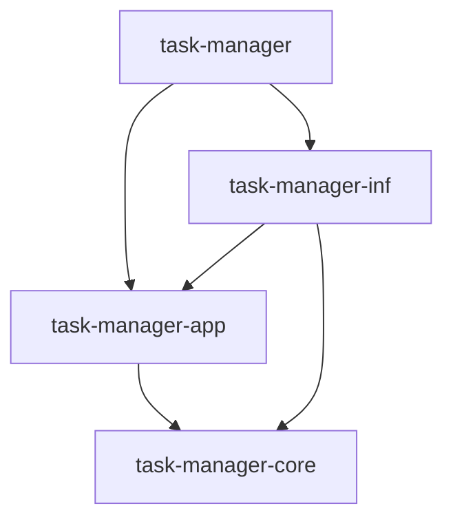

# Arquitectura

## Enfoque

Aplicación en Rust con un ejecutable y dos modos: comandos (CLI) e interfaz interactiva de terminal (TUI). Ambos usan los mismos casos de uso.

Los datos se guardan en un archivo SQLite local mediante SeaORM. Para compartir datos, las ejecuciones deben usar el mismo archivo. No hay servidor central.

## Crates

| Crate | Responsabilidad |
|---|---|
| `task-manager` | Arranque, configuración, CLI y TUI. Conecta los componentes. |
| `task-manager-core` | Entidades, validaciones y reglas de negocio. |
| `task-manager-app` | Casos de uso, autenticación, permisos, transacciones e interfaces para infraestructura. |
| `task-manager-inf` | Base de datos, migraciones, hash de contraseñas y escritura de logs. |

Las flechas representan dependencias entre crates:

## Bibliotecas

| Biblioteca | Uso principal |
|---|---|
| `clap` | Comandos y argumentos del ejecutable. |
| `ratatui` | Interfaz de terminal del ejecutable. |
| `tokio` | Ejecución asíncrona. Se inicia en el ejecutable. |
| `sea-orm` | Acceso a SQLite, en `inf`. |
| `sea-orm-migration` | Cambios versionados del esquema, en `inf`. |
| `argon2` | Hash y verificación de contraseñas, en `inf`. |
| `tracing` | Emisión de eventos desde `app` e `inf`. |
| `tracing-subscriber` | Formato y destino de logs, configurados en `inf`. |
| `tracing-appender` | Escritura de archivos desde otro hilo, en `inf`. |
| `time` | Fechas, donde se necesiten. |
| `thiserror` | Errores, donde se necesiten. |

Crossterm se usa mediante `ratatui::crossterm`, sin agregarlo por separado.

Las versiones y features se validarán al agregar las dependencias.

## Reglas entre capas

`core` contiene las reglas de negocio y no conoce la terminal ni la base de datos.

`app` define los casos de uso y las interfaces para persistencia, contraseñas y auditoría. CLI y TUI acceden a los datos mediante estos casos de uso.

`inf` convierte los modelos y errores de SeaORM a tipos de la aplicación. CLI y TUI reciben resultados sin contraseñas ni hashes.

CLI y TUI se encargan de la interacción y la presentación. Las reglas compartidas permanecen en `app` y `core`.

## Acceso y ejecución

El ejecutable carga la configuración, prepara la infraestructura e inicia CLI o TUI.

Los comandos autentican cada invocación. La TUI autentica al entrar y conserva la identidad en memoria. La creación del administrador inicial tiene una entrada específica sin autenticación previa.

Cada operación de negocio sigue estos pasos:

1. Verificar la identidad, el bloqueo y los permisos actuales.
2. Validar y ejecutar el caso de uso.
3. Confirmar los cambios, si corresponde.
4. Emitir la auditoría correspondiente y devolver el resultado.

`app` centraliza estas comprobaciones para ambos modos. La protección de contraseñas se implementa en `inf` con Argon2. Las credenciales no aparecen en resultados ni logs.

## Persistencia y transacciones

`inf` implementa el acceso a SQLite mediante SeaORM. `app` define qué cambios forman una transacción e `inf` la ejecuta. Si falla, se revierten sus cambios.

Los errores de persistencia se convierten en errores de aplicación antes de llegar a CLI o TUI.

Las migraciones se mantienen en `inf` y se ejecutan con `sea-orm-migration`.

## Auditoría y logs

Los logs se emiten después de la acción: tras confirmar los cambios o conocer el error.

`tracing` emite el evento, `tracing-subscriber` le da formato y `tracing-appender` lo escribe en un archivo desde otro hilo.

La auditoría es independiente de la transacción: un fallo del log no revierte la acción. Los logs no interfieren con la TUI y los filtros de diagnóstico no desactivan la auditoría.

## Ejecución asíncrona y presentación

Tokio ejecuta las operaciones asíncronas, incluido el acceso a datos con SeaORM.

La TUI mantiene su estado y actualiza la pantalla con los resultados de `app`. Las operaciones de datos y el trabajo costoso se ejecutan sin bloquear el dibujo de la interfaz.

## Configuración y fechas

Las rutas de SQLite y logs son configurables. Las fechas se obtienen del sistema, se guardan en UTC con `time` y se formatean al mostrarlas.

## Validación prevista

Las pruebas cubren reglas de dominio, casos de uso e integración con SQLite y logs. Se comprueba que CLI y TUI apliquen las mismas reglas de acceso.

## Gestión de usuarios

Solo los administradores pueden bloquear y desbloquear cuentas (RF-29 y CU-05). El bloqueo se comprueba al autenticar y antes de cada operación, también en una TUI ya abierta (RF-15, RNF-02 y CU-02).

Para eliminar un usuario se intenta el borrado en la base de datos. Si esta lo rechaza por asociaciones de datos, como una restricción de clave foránea, `inf` convierte el fallo en un error de aplicación y CLI o TUI informa que el usuario no se puede eliminar por estar asociado a otros datos (RF-24 y CU-06). El error se registra después de conocer el resultado, conforme a RF-09.
